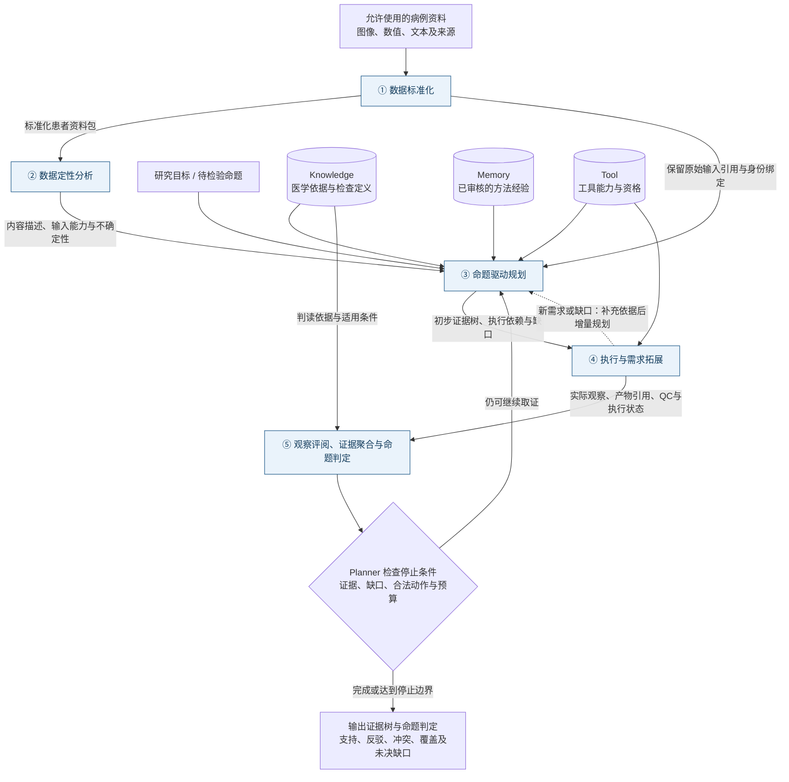
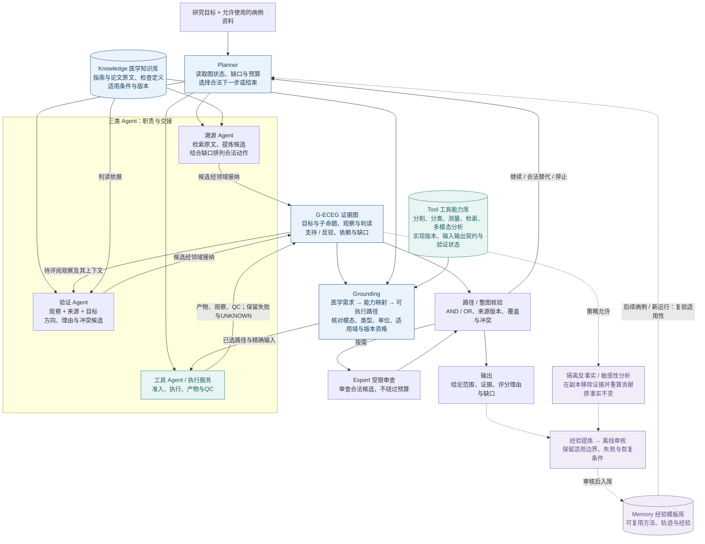

# MMAgent

MMAgent 围绕一个待检验命题，将多模态资料整理、数据定性分析、证据规划、工具执行和观察评阅组织为可追溯的研究流程。系统以目标驱动可执行临床证据图（G-ECEG）保存命题、观察、判读、依赖和缺口，并通过 Knowledge、Tool、Memory 三库提供依据、执行能力和可复用经验。

本仓库是源代码快照。下文说明流程与模块职责，不表示所有路径均已完成端到端验收，也不代表输出已经获得临床有效性验证。

## 五步骤工作流程

五步骤由 Planner 组织推进。资料准备和数据定性分析先说明“当前有什么”，命题驱动规划再确定“需要检查什么”，执行与评阅分别回答“实际得到什么”和“这些观察说明什么”。



### 第一步：数据标准化

**输入：** 允许使用的原始病例资料，以及来源、患者身份、眼别、访视和时间范围等信息。

**处理：** 通过数据适配器统一图像、数值和文本的组织形式，保留原始值、单位声明、组件身份和来源引用。预测任务只暴露该任务允许使用的资料；评价标签与模型输入分离。

**输出：** 标准化患者资料包及可追溯的组件索引，为后续步骤提供同一套输入身份和引用。缺失信息保持缺失，未知单位保留未知。

### 第二步：数据定性分析

**输入：** 标准化患者资料包，以及明确允许分析的材料范围。

**处理：** 描述资料的类型、模态、内容、可见区域、质量限制和组织关联；区分来源声明、实际观察与模型推断。这一步不读取疾病命题，不生成检查需求或医学评分。

**输出：** 绑定到具体输入组件的数据描述、能力信息、语义候选与不确定性记录。后续规划据此判断材料可能支持哪些检查，而不是提前获得诊断答案。

### 第三步：命题驱动规划

**输入：** 待检验命题、标准化资料包、数据定性结果，以及三库中当前可用的医学依据、工具能力和已审核方法经验。

**处理：** Planner 将命题分解为检查需求，通过 Grounding 匹配输入与工具，组织 AND 依赖和 OR 替代路径，复验 Memory 方法的适用性，并对共享节点去重。兼容输入已存在但质量或局部可见性待核的节点，可以带条件进入执行队列。

**输出：** 当前病例、当前命题的初步证据树，包括已选节点、输入与工具绑定、执行依赖、待核条件和明确缺口。“选入检查”只表示可以安排执行，不表示已经取得有效观察。

### 第四步：执行与需求拓展

**输入：** 初步或增量证据树、已选执行路径、当前病例的精确输入引用，以及执行预算和准入条件。

**处理：** 工具执行服务进行输入检查、调用和 QC，保存产物及执行状态。若出现新需求或缺口，由相应服务补充来源、定义或能力核验，再进行增量规划；已确认完成的节点不因扩展而重复执行。

**输出：** 当前病例的实际观察、工具产物引用、QC、逐节点执行记录、更新后的树与需求拓展请求。图像生成或缩放完成只表示输入准备就绪；失败、UNKNOWN 和缺输入不能改写为医学阴性。本步不直接产生根命题分数。

### 第五步：观察评阅、证据聚合与命题判定

**输入：** 已取得的观察、对应医学原文与判读依据、目标命题、质量信息和证据依赖关系。

**处理：** 验证与评阅角色提出支持或反驳方向、理由和冲突，经领域服务接纳后，由确定性程序加权、处理同源重复及输入依赖，并聚合到父节点和根命题。必要时按策略进行受限 Expert 审查及证据移除敏感性分析。

**输出：** 可追溯的判读与节点评分、根命题的支持和反驳汇总、冲突与覆盖情况、未决缺口，以及继续取证或结束的状态。父节点汇总其唯一叶证据集合，不额外重复投票；中性、未判读和反驳分别保留。研究评分不直接解释为疾病概率。

## Knowledge–Tool–Memory 三库协同

三库在同一流程中提供不同材料。医学需求与可执行路径通过 **Grounding** 连接，当前病例的观察与判读进入 **G-ECEG**；运行后的经验经过离线审核，再进入 **Memory**，供后续病例或新运行使用。



### 三库分别提供什么

| 库 | 回答的问题 | 提供的材料 |
|---|---|---|
| **Knowledge** | 医学上需要验证什么，取得观察后应依据什么判读？ | 指南和论文原文、检查定义、证据关系、适用条件、精确引用及版本 |
| **Tool** | 系统当前能做什么，需要什么输入，输出如何验证？ | 工具能力、实现与版本、输入输出契约、工作流依赖、运行条件及验证资格 |
| **Memory** | 过去有哪些方法、路径和恢复经验可以用于当前任务？ | 经审核的模板、执行步骤、工具组合、失败模式及事实—反事实经验 |

### 三库怎样协作

1. **从命题到检查需求。** Planner 分派溯源任务，Knowledge 提供原文和检查定义，Memory 提供经过审核的历史方法参考。候选必须重新匹配当前目标和输入，不能直接套用历史结论。
2. **从需求到可执行路径。** Grounding 将医学需求映射到 Tool 能力，核对模态、数据类型、单位、适用范围、版本和依赖。缺能力时记录需求，当前运行在已有合法替代路径与停止之间选择。
3. **从实际产物到证据。** 工具 Agent 取得本例产物和观察，验证 Agent 结合 Knowledge 中的依据提出判读。结构化候选经领域服务校验和接纳后，才能更新图与评分。
4. **从证据图到决策。** 路径与整图核验检查依赖、来源、覆盖和冲突。Planner 根据状态与剩余预算决定继续、替代或结束；Expert 只在需要时受限审查，不绕过执行规则。
5. **从一次运行到后续复用。** 运行轨迹及策略允许的隔离分析形成经验候选，经离线审核后进入 Memory。新病例复用方法、输入角色、工具版本和来源引用，重新获取本例观察与判读。

三个库不会主动互相调用，读取和写入由 Agent、Planner 与对应领域服务协调。当前病例的事实、请求状态和产物引用由 Runtime 及对象服务保存；成功运行也不意味着经验自动获得规划复用资格。

工具扩展属于条件触发的独立流程：可结合 Knowledge 的方法依据和 Memory 的历史经验构建候选工具，经类型、运行与可靠性验证后再注册到 Tool，供后续合规运行使用。隔离副本中的证据移除用于分析贡献与敏感性，不直接解释为医学因果效应。

## 本地开发

需要 Python 3.12。开发依赖和常用检查命令如下：

```bash
make install-dev
make format-check
make lint
make test
```

由于运行时数据、数据库和模型文件不随仓库分发，完整运行需要在仓库外准备相应环境。环境变量模板见 [`.env.example`](.env.example)。

## 目录

- `Algorithm_Tool/`：算法工具与 CPU 测量实现
- `agents/`：Agent 组件与契约 schema
- `apps/`：应用入口、服务和展示模板
- `packages/`：可复用的 Python 包与 schema
- `Seg_Model/`：分割工具的代码入口；模型文件不随仓库分发
- `tests/`：测试代码
